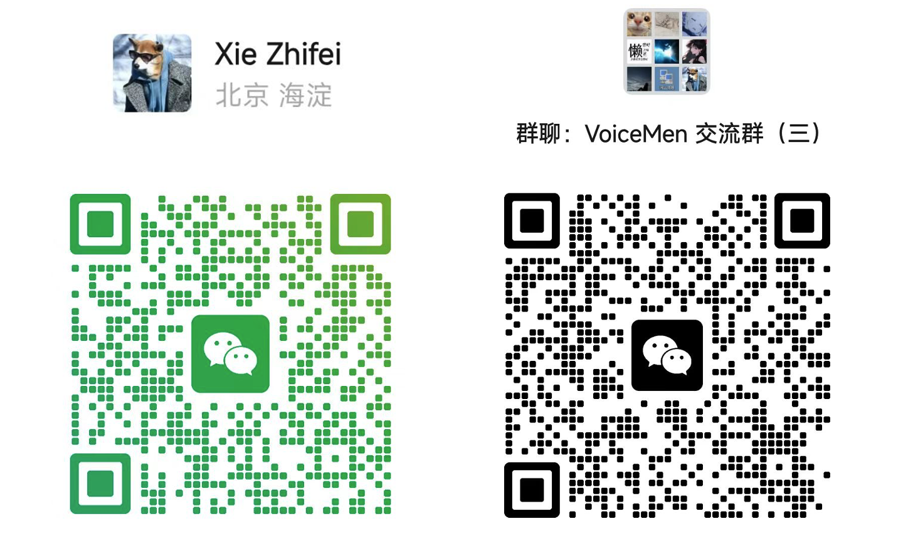
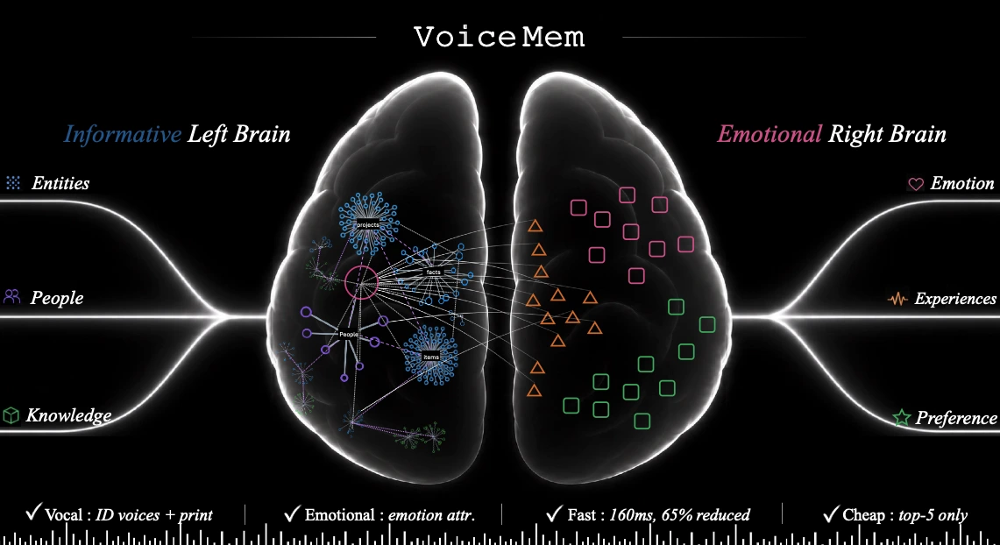
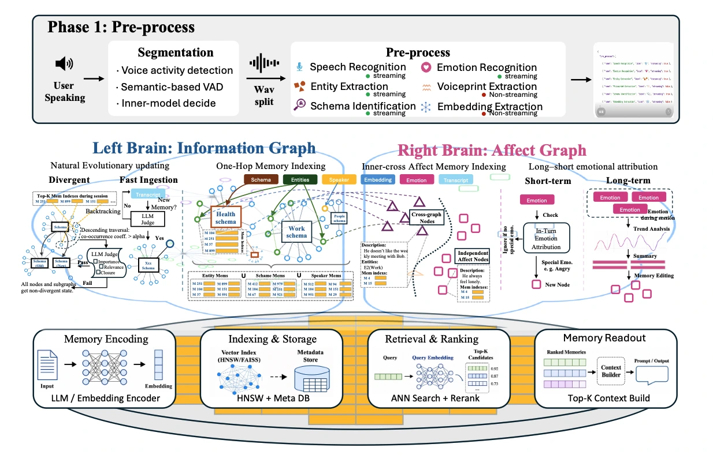
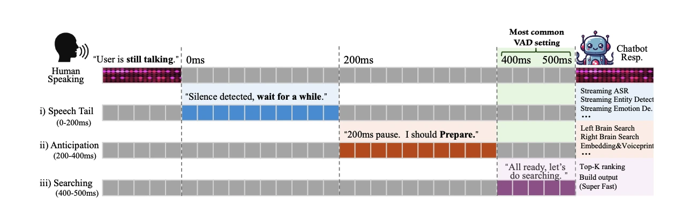
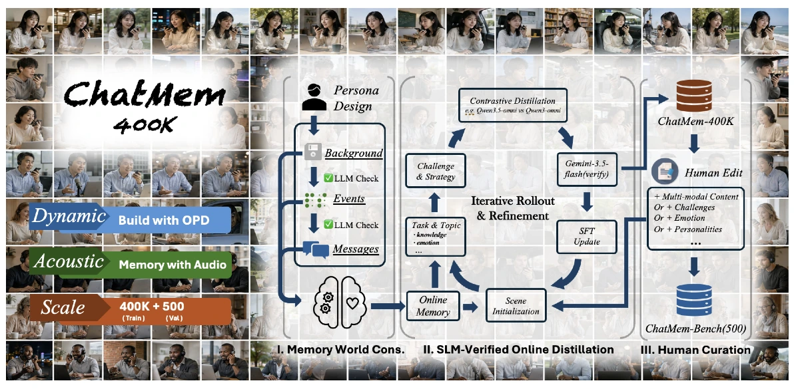
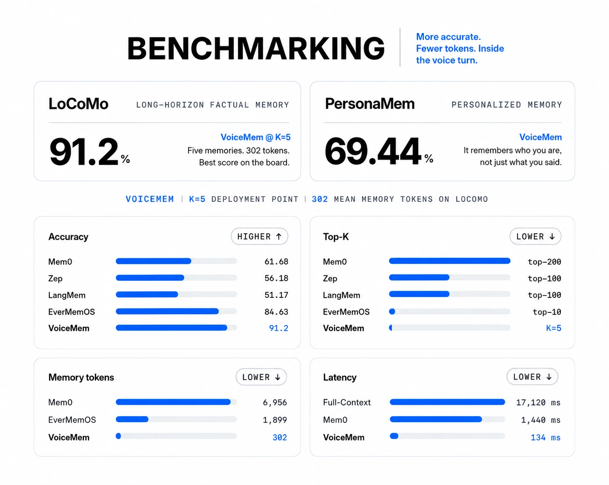

> **[中文化] VoiceMem**
>
> 此项目是 [xzf-thu/VoiceMem](https://github.com/xzf-thu/VoiceMem) 的中文翻译版本。
> - 原项目 Stars: 2501
> - 主语言: Python
> - 许可证: Apache-2.0
> - 翻译日期: 2026-10-14
> - 原始 README: [README_en.md](README_en.md)
>
> 说明：下方 README 正文为**原项目文档的中文翻译**，力求忠于原文；本页顶部的「中文快速上手」为**面向中文用户的补充导读**（非原文内容），目的是让你不用读完整篇 README 就能先把项目跑起来。
>
> 如有翻译不准确之处，欢迎提 Issue 或 PR。

---


## 🚀 中文快速上手（补充导读，非原文）

### 这是什么 / 解决什么问题

VoiceMem 是一个面向实时语音智能体的记忆系统，采用「流式双脑」架构：左脑用 Schema 和 Entity 组织事实记忆，右脑管理人格、情绪和关系信息。它解决的是语音助手「记不住用户说过什么、也不懂用户是谁」的问题，让模型在对话中能检索到相关记忆。项目主语言为 Python，许可证 Apache-2.0。

### 快速上手（最短路径）

1. 克隆仓库并进入目录：
   ```bash
   git clone https://github.com/xzf-thu/VoiceMem.git
   cd VoiceMem
   ```
2. 安装记忆系统（含 ASR / 声纹 / 场景 / 情绪 / 本地 embedding 全套内置组件）：
   ```bash
   pip install voicemem
   ```
3. 可选：安装微调的 Qwen 回复模型：
   ```bash
   pip install "voicemem[slm]"
   ```
4. 下载所需模型：
   ```bash
   pip install -U huggingface_hub
   hf download zhifeixie/VoiceMem_Default_Models_Env --local-dir ./models
   ```
5. 运行交互式演示（演示代码在仓库里，pip 装的包只有库本身，需先克隆并进入仓库目录）：
   ```bash
   python web/run.py
   ```
   然后访问 `http://localhost:8787`。

### 环境要求

- **操作系统**：pyproject.toml 中 classifier 标注为 `OS Independent`，原文未说明具体支持的系统版本。
- **Python 版本**：`requires-python = ">=3.10"`。
- **硬件**：原文未说明明确的硬件要求（如 GPU 显存等）。
- **依赖**：`pip install voicemem` 会装齐所有内置组件，包括 numpy、openai、mem0ai、torch、torchaudio、torchvision、transformers==4.52.3、accelerate、funasr、modelscope 等。
- **网络**：需从 Hugging Face 下载模型（`hf download zhifeixie/VoiceMem_Default_Models_Env`），国内网络环境可能需要更换镜像源或使用加速下载。

### 常见坑与注意事项

- **需要 OpenAI API Key**：示例代码中 `VoiceMem(openai_key="api_xxx")` 或 `os.environ["OPENAI_API_KEY"]`，使用前需准备 API Key。
- **需下载模型文件**：需通过 `hf download` 下载 `zhifeixie/VoiceMem_Default_Models_Env`，属于额外的大文件下载步骤。
- **本地模型懒加载**：示例中特别提示「本地模型是懒加载的，先热起来，别让第一次调用去等加载」，需先调用 `vm.warmup()`。
- **依赖缺失会静默退化**：pyproject.toml 注释指出，缺 `torchvision` 或 `accelerate` 时情绪归因器会**静默**退回纯声学象限（不报错但结果不准），需确保依赖完整安装。

---


---

<a id="chinese"></a>

<p align="center">
  
</p>

<p align="center">
  <strong>中文</strong> | <a href="#english">English</a>
</p>

<p align="center">
  <a href="https://xzf-thu.github.io/VoiceMem/">项目主页 🌐</a> /
  <a href="https://arxiv.org/pdf/2608.26005">技术报告 📖</a> /
  <a href="https://huggingface.co/zhifeixie/VoiceMem_Default_Models_Env">VoiceMem Utils 🤗</a> /
  <a href="https://huggingface.co/zhifeixie/VoiceMem_MF_Qwen3_6_35B_A3B_Qlora">VoiceMem Model Families 🤗</a> /
  <a href="https://huggingface.co/datasets/zhifeixie/VoiceMem-ChatMem400k">ChatMem-400K 🤗</a>
</p>

<p align="center">
  <a href="wechat.png">
    
  </a>
  <a href="https://x.com/XieZhifei14110">
    
  </a>
  <a href="https://xzf-thu.github.io">
    
  </a>
</p>


<div align="center">
  <a href="https://xzf-thu.github.io/VoiceMem/">
    
  </a>
</div>
<p align="center">
  
</p>

---

我们带来 **VoiceMem**，为语音模型增加最后一个组件：灵魂，让它真正越来越懂你。VoiceMem 建立在<strong>「流式双脑」</strong>架构之上，提供**精准、有情感、懂人格、低延迟且最便宜的记忆服务**。本仓库将<strong>「永久保持全部开源」</strong>。

快速理解 VoiceMem：

* **左脑：** 直接管理信息，在 Top-3 限制下维持 Mem0 的满载性能。
* **右脑：** 用长短期情绪归因管理「情商」，含交叉节点、与左脑信息联合维护。
* **低延迟：** 通过压缩信息、分层存储、流式查询（0–300 ms 投机预取），几乎不增加延迟。
* **简单实用：** 单轮查询约 300 token；架构全部解耦，全部组件（含底层记忆引擎）都可更换。

<p align="center">
  
</p>

## 🔥 News

* 💬 **09/01/2026 · [v0.0.2](https://github.com/xzf-thu/VoiceMem/releases/tag/v0.0.2)** — 修复事件日期链路，移除右脑冗余记忆类别，开放可插拔语音合成层。
* 🎉 **08/27/2026 · [v0.0.1](https://github.com/xzf-thu/VoiceMem/releases/tag/v0.0.1)** — 发布初代 **VoiceMem** 和 **Technical Report**。
* 🤖 **08/21/2026** — 开源 **VoiceMem 模型系列**，可直接读取并理解 VoiceMem 提供的记忆。
* 🛠️ **08/21/2026** — 发布 **VoiceMem Utils**，开箱即用。
* 📦 **08/20/2026** — 开源 **ChatMem-400K** 数据集。

## 🎬 Demo

> **注意：** 播放前需要先取消静音。

https://github.com/user-attachments/assets/0d919f8c-e9ba-4fdb-8078-b049e4b99a28


## 📚 目录
* [🚀 快速开始](#-快速开始)
* [🧠 VoiceMem 双脑流式架构](#-voicemem基于流式双脑架构的记忆系统)
* [🤖 VoiceMem 官方记忆模型](#-voicemem-模型系列)
* [🔌 使用 VoiceMem 定制你的语音智能体](#-使用-voicemem-定制你的语音智能体)
* [🛠️ 模型微调](#️-模型微调)
* [📊 评测代码](#-评测)
* [📖 引用](#-引用)
* [致谢](#致谢)
* [许可证](#许可证)

## 🚀 快速开始

### 安装

```bash
git clone https://github.com/xzf-thu/VoiceMem.git
cd VoiceMem

# 安装记忆系统（含 ASR / 声纹 / 场景 / 情绪 / 本地 embedding 全套内置组件）
pip install voicemem

# 可选：用我们微调的 Qwen 回复模型
pip install "voicemem[slm]"
```

### 下载所需模型

```bash
pip install -U huggingface_hub

hf download zhifeixie/VoiceMem_Default_Models_Env --local-dir ./models
```

### 基础用法 <a id="interfaces"></a>

#### 作为离线记忆引擎运行

```python
from voicemem import VoiceMem

vm = VoiceMem(
    mode="normal",
    openai_key="api_xxx",
    top_k=5,
)

# 本地模型是懒加载的，先热起来，别让第一次调用去等加载
vm.warmup()

# 存：音频文件
# 内部跑 ASR / 声纹 / 场景 / 情绪感知 / Embedding 抽取
print("入库开始")
vm.ingest(audio="assets/input.wav")  # 我是素食主义者，对坚果过敏。
print("入库结束")

# 查：写入慢是因为要抽事实、打标签、建图；查询走的是纯向量检索，跟写入无关
print("检索开始")
result = vm.search("我的饮食禁忌是什么？")
print("检索结束")

print(result.result_leftbrain, result.result_rightbrain)


# 存：左脑信息文本（无情感）
vm = VoiceMem(
    mode="leftbrain_only",
    openai_key="api_xxx",
    top_k=5,
)

vm.ingest("我是素食主义者，对坚果过敏。")

result = vm.search("我的饮食禁忌是什么？")
```

#### 以流式方式运行 VoiceMem

可以把 VoiceMem 的流式接口看作一个持续处理音频的 VAD 接口。

下面这段：先显式存一条事实，再喂一段**问句**音频，看记忆是怎么在人还没说完时就查好的；最后照例走一次入库判断。

```python
import asyncio
import os
from pprint import pprint

import numpy as np
import soundfile as sf

from voicemem import VoiceMem

# 沿用上面那个 vm；单独跑这段就自己建一个
vm = VoiceMem(mode="normal", openai_key=os.environ["OPENAI_API_KEY"], top_k=5)

# 本地模型是懒加载的，先热起来，别让第一块音频去等模型加载
vm.warmup()

# 先存一条事实，等下那个问句才有东西可查
vm.ingest("我是素食主义者，对坚果过敏。")

SPEC_MIN_CHARS = 6          
searching = False


def on_partial(text):
    """边说边出字。够长了就说明后台这一刻已经开查了。"""
    global searching
    print(f"\r[partial] {text}", end="", flush=True)
    if not searching and len(text) >= SPEC_MIN_CHARS:
        searching = True
        print("\n[检索开始] 人还没说完，后台已经在查了", flush=True)


async def main():
    # 这段音频里是一个问句：「我的饮食禁忌是什么？」
    audio, sr = sf.read("assets/question.wav", dtype="float32")
    pcm = (np.clip(audio, -1, 1) * 32767).astype(np.int16)

    stream = vm.stream(src_rate=sr, vad_threshold=0.5, on_partial=on_partial)
    step = int(sr * .032)

    for i in range(0, len(pcm), step):
        st = await stream.feed(pcm[i:i + step].tobytes())
        if st.state != "turn_over":                
            continue

        # VAD 确认这一轮说完了。记忆早在说话过程中就查好了，这里直接取，不再等
        print("[检索结束]")
        print("转写  ", st.transcript)
        print("左脑  ", st.result_leftbrain)         
        print("右脑  ", st.result_rightbrain)
        pprint({k: getattr(st, k) for k in
                ["speaker_id", "speaker_voiceprint", "emotion",
                 "entity", "schema", "text_embedding"]})

        # 每一轮都要走一次入库判断
        print("[入库] LLM 正在判断这句话值不值得入库…", flush=True)
        res = vm.ingest(st.transcript)
        print(f"[入库] 抽出 {res['facts_count']} 条事实 -> {res['memory_ids']}")
       


asyncio.run(main())
```

### VoiceMem 交互式演示

演示代码在仓库里（pip 装的包只有库本身），先确认已经克隆并进入仓库目录。

```bash
python web/run.py
```

然后访问：

```text
http://localhost:8787
```

Demo 默认把终端输出（含 Python logging 和 Uvicorn 的日志）保存一份到
`results/logs/voicemem-时间-PID.log`，每行带时间戳和 stdout/stderr 标记。
启动时终端会打印实际路径。指定文件或临时关闭如下。

```bash
python web/run.py --log-file results/logs/debug.log
python web/run.py --no-file-log
```

回复模型的上下文由当前输入、本次会话尚未入库的对话和检索记忆组成。每轮对话先
进入内存 SessionBuffer；异步记忆写入完成并确认产生持久记忆后，对应 turn 从
SessionBuffer 移除。没有产生长期记忆的临时对话会保留到本次会话结束，不同
Memory Space 和不同 WebSocket 会话互相隔离。

播放期间的插话使用两阶段控制：VAD 首先暂停并保留音频队列；明确停止指令或稳定
ASR 文本确认后才清空队列并取消回复；附和、回声、无文字声音和单音节碎片会恢复
播放。候选静音回退和最长等待时间可分别通过 `BARGE_REJECT_SILENCE_MS`、
`BARGE_CANDIDATE_TIMEOUT_MS` 调整。

两种回复模式共用以 PCM 样本位置为基准的输出时间轴。浏览器 AudioWorklet 回报
实际渲染进度，打断时只把已经播放的回复写入 SessionBuffer。TTS 后端可选返回
`TimedAudioChunk` 提供文字对齐；普通 PCM 后端按分段音频长度和动态语速估算。

## 🧠 VoiceMem：基于流式双脑架构的记忆系统

**VoiceMem** 是一个面向实时语音智能体的记忆系统。

VoiceMem 不把所有记忆放进同一个检索数据库，而是将记忆拆分成两个互相配合的部分：

<p align="center">
  
</p>

* **左脑**通过 Schema 和 Entity 组织事实记忆，用于更加准确地检索信息。
* **右脑**通过独立节点和跨实体节点管理人格、情绪和关系信息。

<p align="center">
  
</p>

整个流程都是**流式**的。

在用户仍然说话时，VoiceMem 会持续完成音频分段、语音转写、记忆提取，并把结构化信息写入记忆图中。

查询时，VoiceMem 会**先路由，再排序，最后只把 Top-K 条记忆注入模型上下文**，从而在保留相关信息的同时控制上下文长度。

### 主要特性

* 🎯 **精准** — 在 **LoCoMo 上达到 91.2%**，Mem0 为 **61.68%**，并且只需要 **Top-5** 条记忆。
* ❤️ **有情感、懂人格** — 不只记住**用户说过什么**，还会记住**用户是谁、用户有什么感受**。在 **PersonaMem 上达到 69.44%**。
* 🎧 **多模态** — 可以从真实世界音频中记住**语音、说话人、声音事件、多人对话和音乐**。
* ⚡ **低延迟** — 响应时间为 **134 ms**，Mem0 为 **1,440 ms**，并支持在语音轮次内部进行流式检索。
* 💰 **低 Token 消耗** — 每次只使用 **430 个记忆 token**，Mem0 为 **6,956**，EverMemOS 为 **1,899**。


## 🤖 VoiceMem 模型系列

我们通过三阶段 OPD 训练流程构建 **ChatMem-400K**：

1. **Memory-world construction**
2. **SLM-validated online on-policy distillation（OPD）**
3. **Human refinement**

同一套流程在人工编辑后形成 **ChatMem-Bench**，评测语音模型是否能够在长期沉淀中形成对用户的理解。

VoiceMem 家族开源模型包括 **Qwen2.5-Omni、Qwen3-Omni 和 Step-Audio2-Mini**。这些模型可以在对话时接受并理解 VoiceMem 提供的记忆信息。

<p align="center">
  
</p>

## 🔌 使用 VoiceMem 定制你的语音智能体

你可以将 VoiceMem 接入自己的语音模型，用于构建带有长期记忆能力的实时语音智能体。

整体流程如下：

**麦克风 → VoiceMem 监听语音并提前检索相关记忆 → 你的模型读取这些记忆并生成回答**

```bash
export OPENAI_API_KEY=sk-...
# 仅在写入记忆时用于事实信息提取。
# 记忆检索完全在本地运行。

python examples/03_simple_agent_with_voicemem_memory.py
```

换成你自己的模型：把生成那一步换掉就行，记忆那半边一行都不用动。

```python
def my_reply(text, memory_context):        # 同步函数也可以，会自动丢线程
    return my_model.generate(system=memory_context, user=text)

vm = VoiceMem(reply=my_reply)
```

## 🛠️ 模型微调

VoiceMem 提供完整的微调代码，可用于训练自己的 VoiceMem Model Family Adapter。

默认训练配置与发布的 `checkpoint-3318` 使用的配置一致。

使用默认参数运行下面的命令，可以复现相同的 Adapter：

```bash
pip install ms-swift==4.5.2 bitsandbytes

python finetune/train.py --data data/train.jsonl
```

训练数据格式、GPU 显存要求，以及如何更换基础模型，请参阅 **[finetune/README.md](finetune/README.md)**。

## 📊 评测

评测流程完全开源，并且可以复现。

<p align="center">
  
</p>

### 运行评测

只需要一条命令即可运行 Benchmark：

```bash
export OPENAI_API_KEY=sk-...

# 建议先运行仓库中自带的小型示例，
# 确认环境和配置没有问题。
# 2 个对话，5 个问题。
python evaluation/run.py \
    --dataset locomo \
    --data evaluation/examples/locomo_sample.json

# 然后运行完整数据集。
python evaluation/run.py \
    --dataset locomo \
    --data data/locomo.json
```

示例结果：

```text
LoCoMo: 10 conversations · 152 questions

Score: 139/152 = 91.4%

  multi_hop     88.2%
  temporal      85.7%
  single_hop    95.1%

Median retrieval latency: 12 ms
Median retrieved memory: 298 tokens
```

在运行完整评测之前，可以加入 `--inspect`，检查数据集是否被正确解析。

这个模式不会调用模型，因此也不会产生 API 费用：

```bash
python evaluation/run.py \
    --dataset locomo \
    --data data/locomo.json \
    --inspect
```

评测过程中，回答模型**只会收到检索得到的记忆**，不会收到原始对话历史。

如果直接把完整对话交给模型，Benchmark 测试的就会变成模型的阅读理解能力，而不是记忆系统本身的能力。

完整评测流程，以及添加新 Benchmark 的方法，请参阅 **[evaluation/README.md](evaluation/README.md)**。添加一个新的 Benchmark 只需要增加一个文件并实现两个函数。

## 📖 引用

如果 VoiceMem 对你的研究有帮助，请引用我们的论文：

```bibtex
@misc{2608.26005,
  author = {Zhifei Xie and Jiaqi Lang and Ze An and Yifan Zhao and Dongchao Yang and Kai Li and Ziyang Ma and Mingbao Lin and Chunyan Miao and Shuicheng Yan},
  title = {{V}oice{M}em: {S}treaming {D}ual-{B}rain {M}emory for {R}eal-{T}ime {I}nteraction},
  year = {2026},
  eprint = {2608.26005},
  note = {arXiv:2608.26005v1}
}
```

<div align="center">
  <a href="https://star-history.dera.page/#xzf-thu/VoiceMem&type=date&legend=top-left">
    <picture>
      <source media="(prefers-color-scheme: dark)" srcset="https://star-history.dera